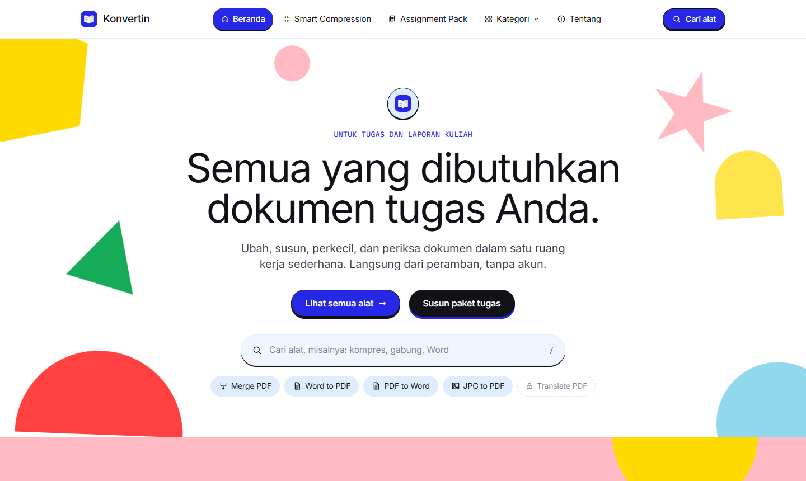
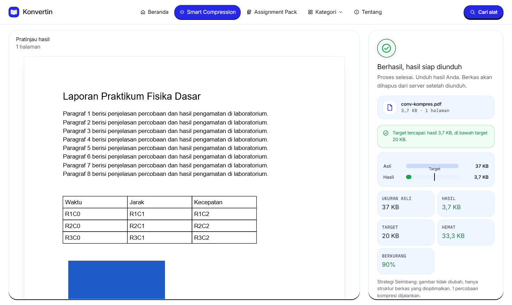
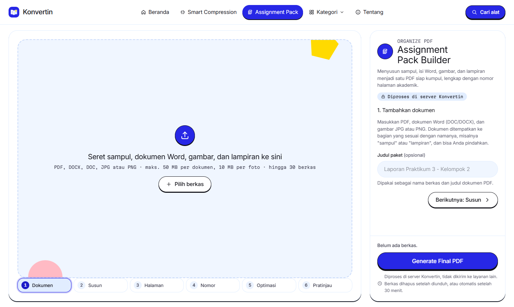
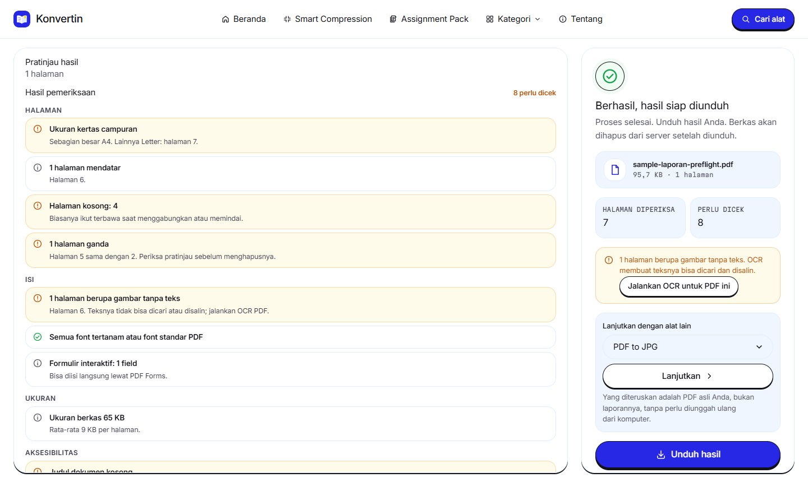
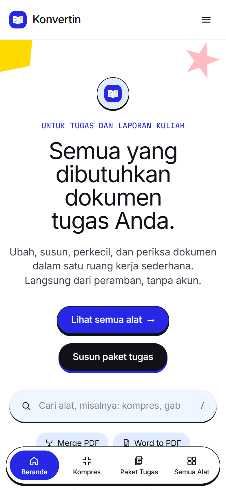

<p align="center">
  
</p>

<h1 align="center">Konvertin</h1>

<p align="center">
  Ruang kerja PDF dan dokumen untuk tugas dan laporan kuliah.<br>
  Ubah, susun, perkecil, dan periksa dokumen langsung dari peramban, tanpa akun.
</p>

<p align="center">
  
  
  
  
</p>

<p align="center">
  
</p>

---

## Daftar isi

- [Tentang](#tentang)
- [Fitur unggulan](#fitur-unggulan)
- [Semua alat](#semua-alat)
- [Privasi dan keamanan berkas](#privasi-dan-keamanan-berkas)
- [Cara kerja](#cara-kerja)
- [Kebutuhan sistem](#kebutuhan-sistem)
- [Menjalankan di komputer sendiri](#menjalankan-di-komputer-sendiri)
- [Konfigurasi](#konfigurasi)
- [Pengujian](#pengujian)
- [Deploy](#deploy)
- [Struktur proyek](#struktur-proyek)

## Tentang

Konvertin mengumpulkan 34 alat PDF dan dokumen dalam satu antarmuka yang dirancang untuk kebutuhan mahasiswa: menggabungkan laporan, memperkecil PDF agar lolos batas unggah portal kampus, memeriksa berkas sebelum dikumpulkan, hingga menyusun paket tugas lengkap dengan nomor halaman akademik.

Prinsip yang dipegang:

- **Tanpa akun.** Buka halaman alat, unggah, proses, unduh.
- **Jujur terhadap hasil.** Progres, ukuran, dan laporan diukur dari berkas sebenarnya, bukan perkiraan atau angka hiasan.
- **Berkas tidak disimpan.** Berkas diproses di folder sementara yang terisolasi, lalu dihapus setelah diunduh atau setelah 30 menit.
- **Pemrosesan dijelaskan.** Setiap alat menyebutkan di mana dokumen diproses: di peramban, di server Konvertin, atau di layanan eksternal.

## Fitur unggulan

| | |
|---|---|
|  | **Smart Compression**<br>Tentukan ukuran maksimal, misalnya 2 MB untuk portal kampus. Kompresi dilakukan bertahap dan berhenti di tahap pertama yang sudah memenuhi target, sehingga kualitas tidak diturunkan lebih dari yang perlu. Mendukung banyak PDF sekaligus lewat antrean. |
|  | **Assignment Pack Builder**<br>Gabungkan sampul, laporan Word, screenshot, dan lampiran menjadi satu PDF. Nomor halaman Romawi untuk bagian awal dan Arab untuk isi, bookmark per bagian, serta pratinjau sebelum ekspor. |
|  | **Preflight Check**<br>Periksa PDF sebelum dikumpulkan: halaman kosong atau ganda, ukuran kertas campuran, halaman hasil scan tanpa teks, font, aksesibilitas, dan tanda tangan digital. Hasilnya bisa langsung diteruskan ke OCR atau alat lain tanpa mengunggah ulang. |

Fitur pendukung di seluruh alat:

- **Antrean pemrosesan** untuk banyak berkas (hingga 30 per proses), dengan hasil per berkas dan unduhan ZIP.
- **Pemrosesan lokal di peramban** untuk Merge, Rotate, dan Organize PDF. Berkas tidak dikirim ke server sama sekali.
- **Lanjutkan dengan alat lain**: hasil satu alat dapat langsung menjadi masukan alat berikutnya.
- **Pemulihan unduhan**: tautan hasil tetap berlaku selama masa simpan bila halaman tertutup.
- **OCR lokal** (RapidOCR) dengan skor keyakinan per baris dan koreksi manual, tanpa layanan eksternal.

<p align="center">
  
</p>

## Semua alat

<details>
<summary><b>Convert PDF</b> (12 alat)</summary>

| Alat | Fungsi |
|---|---|
| JPG to PDF | Mengubah gambar JPG atau PNG menjadi PDF. |
| Word to PDF | Mengubah DOC/DOCX menjadi PDF. ¹ |
| PowerPoint to PDF | Mengubah PPT/PPTX menjadi PDF. ¹ |
| Excel to PDF | Mengubah XLS/XLSX menjadi PDF. ¹ |
| HTML to PDF | Mengubah halaman web menjadi PDF. ² |
| Scan to PDF | Memotret atau mengunggah hasil pindai lalu menyatukannya menjadi PDF. |
| PDF to JPG | Mengubah halaman PDF menjadi gambar JPG atau PNG dengan resolusi pilihan. |
| PDF to Word | Mengubah PDF menjadi DOCX. |
| PDF to PowerPoint | Mengubah PDF menjadi PPTX. |
| PDF to Excel | Mengubah PDF menjadi XLSX. |
| PDF to PDF/A | Mengubah PDF menjadi format standar pengarsipan jangka panjang. ³ |
| PDF to Markdown | Mengubah isi PDF menjadi Markdown. |

</details>

<details>
<summary><b>Organize PDF</b> (8 alat)</summary>

| Alat | Fungsi |
|---|---|
| Assignment Pack Builder | Menyusun sampul, isi Word, gambar, dan lampiran menjadi satu PDF siap kumpul. |
| Merge PDF | Menggabungkan beberapa PDF menjadi satu. Diproses di peramban. |
| Split PDF | Memisahkan PDF berdasarkan rentang, halaman tertentu, atau jumlah halaman. |
| Organize PDF | Menyusun ulang, menghapus, memutar, dan menyisipkan halaman lewat thumbnail. Diproses di peramban. |
| Bookmark PDF | Melihat, membuat, mengubah, dan menyusun bookmark bertingkat. |
| Rotate PDF | Memutar seluruh halaman, halaman tertentu, atau rentang halaman. Diproses di peramban. |
| Crop PDF | Memotong area halaman dengan seleksi atau pengaturan margin. |
| Create Workflow | Menjalankan beberapa alat berurutan dalam satu proses, misalnya gabung, kompres, lalu kunci. |

</details>

<details>
<summary><b>Optimize PDF</b> (4 alat)</summary>

| Alat | Fungsi |
|---|---|
| Smart Compression | Memperkecil PDF sampai di bawah ukuran target. |
| Preflight Check | Memeriksa PDF sebelum dikumpulkan dan memberi laporan per kategori. |
| Repair PDF | Memeriksa dan mencoba memperbaiki struktur PDF yang rusak. |
| OCR PDF | Menambahkan lapisan teks yang bisa dicari dan disalin pada PDF hasil pindai. |

</details>

<details>
<summary><b>Edit PDF</b> (3 alat)</summary>

| Alat | Fungsi |
|---|---|
| Edit PDF | Menambahkan teks, gambar, bentuk, highlight, komentar, dan coretan. |
| Page Numbers | Menambahkan nomor halaman dengan posisi, format, dan gaya pilihan. |
| Watermark PDF | Menambahkan watermark teks atau gambar dengan transparansi dan rotasi. |

</details>

<details>
<summary><b>PDF Security</b> (5 alat)</summary>

| Alat | Fungsi |
|---|---|
| Protect PDF | Mengunci PDF dengan kata sandi dan enkripsi AES-256. |
| Unlock PDF | Menghapus kata sandi PDF bila kata sandinya diketahui. |
| Sign PDF | Menambahkan tanda tangan elektronik visual: digambar, diketik, atau diunggah. |
| Redact PDF | Menghapus teks dan area sensitif secara permanen, termasuk metadata. |
| Compare PDF | Membandingkan dua versi PDF dan menandai teks yang berubah. |

</details>

<details>
<summary><b>PDF Forms</b> dan <b>Translate PDF</b> (2 alat)</summary>

| Alat | Fungsi |
|---|---|
| PDF Forms | Mengisi field formulir PDF dan menambahkan field teks atau checkbox baru. |
| Translate PDF | Menerjemahkan PDF ke 12 bahasa dengan posisi judul, paragraf, dan tabel dipertahankan. ⁴ |

</details>

Alat yang mesinnya belum tersedia di server tetap tampil, tetapi diberi label **Belum disiapkan** dan tidak bisa dipakai:

1. Butuh salah satu dari: [Gotenberg](https://gotenberg.dev) (disarankan), LibreOffice, atau Microsoft Office (Windows, hanya untuk pengembangan lokal).
2. Butuh Chromium atau Google Chrome.
3. Butuh Gotenberg atau Ghostscript.
4. Butuh API key Anthropic. Teks dokumen dikirim ke layanan Claude dari Anthropic, dan pengguna selalu diberi tahu sebelum itu terjadi.

Semua alat lain berjalan dengan mesin Python bawaan proyek ini.

## Privasi dan keamanan berkas

- **Validasi isi berkas.** Jenis berkas diperiksa dari isinya (magic bytes), bukan dari ekstensi nama berkas.
- **Penyimpanan sementara yang terisolasi.** Setiap proses mendapat folder acak 40 karakter yang terikat ke sesi pemiliknya.
- **Penghapusan otomatis.** Berkas dihapus setelah diunduh, atau setelah 30 menit bila tidak diunduh. Penjadwal `konvertin:purge` berjalan setiap 5 menit.
- **Tidak ada pencatatan isi.** Kata sandi dan isi dokumen tidak pernah ditulis ke log.
- **Batas sumber daya.** Ada batas ukuran per berkas, jumlah berkas, jumlah halaman, waktu proses, dan laju permintaan per alamat klien.
- **Perlindungan HTML to PDF.** Alamat web diperiksa agar tidak menjangkau jaringan internal (SSRF).
- **Tanpa kunci di frontend.** API key hanya ada di server.
- **Pemrosesan lokal.** Merge, Rotate, dan Organize PDF berjalan sepenuhnya di peramban dengan [pdf-lib](https://pdf-lib.js.org).

## Cara kerja

```
Peramban ── unggah ──▶ Laravel (validasi, batas, sesi)
                           │
                           ▼
                 Folder sementara terisolasi
                           │
           ┌───────────────┼──────────────────┬───────────────────┐
           ▼               ▼                  ▼                   ▼
    Mesin Python    Gotenberg/LibreOffice   Ghostscript     Claude API
    (PyMuPDF, OCR)  (Office ke PDF)         (PDF/A)         (Translate PDF)
           │
           ▼
   Validasi hasil ──▶ progres (NDJSON) ──▶ unduh satu kali ──▶ berkas dihapus
```

- **Laravel 13 (PHP 8.5)** menangani halaman, validasi, ruang kerja sementara, dan unduhan.
- **Mesin Python** ([`resources/engines/konvertin_engine.py`](resources/engines/konvertin_engine.py)) menjalankan sebagian besar operasi PDF dengan PyMuPDF, pdf2docx, python-pptx, openpyxl, OpenCV, dan RapidOCR. Opsi dikirim lewat stdin dan progres dilaporkan lewat stderr.
- **Frontend** memakai Vite, Tailwind CSS 4, CSS buatan sendiri (sistem desain Desain2), pdf.js untuk pratinjau, dan pdf-lib untuk pemrosesan lokal.

## Kebutuhan sistem

| Komponen | Versi | Keterangan |
|---|---|---|
| PHP | 8.5 | Ekstensi: `mbstring`, `zip`, `fileinfo`, `pdo_sqlite`, `openssl` |
| Composer | 2.x | |
| Node.js | 22 | Hanya untuk build aset |
| Python | 3.11 atau lebih baru | Pustaka di [`resources/engines/requirements.txt`](resources/engines/requirements.txt) |
| Ghostscript | opsional | PDF to PDF/A |
| Gotenberg 9.8 atau LibreOffice | opsional | Word/PowerPoint/Excel to PDF |
| Chromium | opsional | HTML to PDF |
| API key Anthropic | opsional | Translate PDF |

Tidak perlu database eksternal: sesi memakai cookie terenkripsi, cache memakai berkas, dan SQLite cukup untuk tabel bawaan Laravel.

## Menjalankan di komputer sendiri

```bash
git clone <url-repositori> konvertin
cd konvertin

# Dependensi PHP dan aset frontend
composer install
npm ci --ignore-scripts
npm run build

# Lingkungan
cp .env.example .env
php artisan key:generate

# Mesin Python (disarankan di virtualenv)
python -m venv .venv
.venv/bin/pip install -r resources/engines/requirements.txt          # macOS/Linux
# .venv\Scripts\pip install -r resources/engines/requirements.txt    # Windows
```

Arahkan `KONVERTIN_PYTHON` di `.env` ke Python virtualenv tersebut, misalnya `KONVERTIN_PYTHON=.venv/bin/python` (atau `.venv\Scripts\python.exe` di Windows), lalu jalankan:

```bash
php artisan serve
```

Buka `http://127.0.0.1:8000`. Perintah `serve` di proyek ini otomatis menaikkan batas unggah PHP sesuai konfigurasi Konvertin, hanya untuk proses server tersebut, tanpa mengubah `php.ini`.

Untuk pengembangan frontend dengan hot reload, jalankan `npm run dev` di terminal terpisah. Untuk menguji pembersihan berkas kedaluwarsa, jalankan `php artisan schedule:work`.

## Konfigurasi

Semua pengaturan Konvertin ada di [`config/konvertin.php`](config/konvertin.php) dan dapat diubah lewat `.env`:

| Variabel | Bawaan | Fungsi |
|---|---|---|
| `KONVERTIN_MAX_FILE_KB` | `51200` | Ukuran maksimal per dokumen (50 MB) |
| `KONVERTIN_MAX_IMAGE_KB` | `10240` | Ukuran maksimal per foto (10 MB) |
| `KONVERTIN_MAX_FILES` | `30` | Jumlah berkas per proses |
| `KONVERTIN_MAX_PAGES` | `500` | Jumlah halaman per dokumen |
| `KONVERTIN_TTL_MINUTES` | `30` | Masa simpan hasil yang belum diunduh |
| `KONVERTIN_PROCESS_TIMEOUT` | `180` | Batas waktu satu proses (detik) |
| `KONVERTIN_RATE_LIMIT` | `20` | Permintaan konversi per menit per alamat klien |
| `KONVERTIN_PYTHON` | `python` | Lokasi interpreter Python untuk mesin konversi |
| `KONVERTIN_WORKSPACE_PATH` | `storage/app/konvertin` | Folder berkas sementara |
| `KONVERTIN_FORCE_HTTPS` | aktif di produksi | Mengalihkan HTTP ke HTTPS dan mengirim HSTS |
| `KONVERTIN_TRUSTED_PROXIES` | kosong | `*` atau daftar IP proxy, wajib diisi bila di balik reverse proxy |
| `KONVERTIN_GOTENBERG_URL` | kosong | Alamat Gotenberg (wajib HTTPS kecuali localhost) |
| `KONVERTIN_GOTENBERG_USERNAME` / `_PASSWORD` | kosong | Basic auth Gotenberg |
| `KONVERTIN_LIBREOFFICE`, `KONVERTIN_BROWSER`, `KONVERTIN_GHOSTSCRIPT` | kosong | Lokasi program; kosong berarti dicari otomatis |
| `KONVERTIN_ANTHROPIC_API_KEY` | kosong | Mengaktifkan Translate PDF |
| `KONVERTIN_AI_MODEL` | `claude-opus-5-5` | Model untuk Translate PDF |

## Pengujian

```bash
php artisan test            # seluruh tes
vendor/bin/pint --test      # pemeriksaan format kode
```

Tes yang membutuhkan pustaka Python otomatis dilewati bila pustakanya belum terpasang. Setiap push ke `main` dan setiap pull request menjalankan tes, Pint, dan build image Docker lewat GitHub Actions ([`.github/workflows/tests.yml`](.github/workflows/tests.yml)).

## Deploy

### Docker (disarankan)

[`Dockerfile`](Dockerfile) membangun satu image berisi PHP 8.5, Apache, mesin Python, dan Ghostscript, dengan aset frontend yang sudah di-build:

```bash
docker build -t konvertin .

docker run -d -p 8080:8080 \
  -e APP_KEY=base64:GANTI_DENGAN_KUNCI_ANDA \
  -e APP_URL=https://konvertin.domain-anda.com \
  konvertin
```

Buat `APP_KEY` dengan `php artisan key:generate --show`. Image ini sudah mengatur:

- `APP_ENV=production` dan `APP_DEBUG=false`. HTTPS dipaksa dan header HSTS dikirim.
- `KONVERTIN_TRUSTED_PROXIES=*`, karena platform hosting mengakhiri HTTPS di proxy-nya.
- Port mengikuti variabel `PORT` dari platform (bawaan `8080`).
- Batas unggah PHP sudah disetel untuk 30 berkas × 50 MB.
- Saat kontainer mulai, cache konfigurasi, rute, dan view dibuat, migrasi SQLite dijalankan, dan penjadwal pembersihan berkas dihidupkan.
- Health check di `/up`.

Build arg opsional:

```bash
docker build --build-arg WITH_CHROMIUM=1 -t konvertin .     # mengaktifkan HTML to PDF
docker build --build-arg WITH_LIBREOFFICE=1 -t konvertin .   # mengaktifkan Office to PDF (image lebih besar)
```

Untuk Office to PDF, cara yang lebih ringan adalah menjalankan [Gotenberg](https://gotenberg.dev) (`gotenberg/gotenberg:9.8.0-libreoffice`) sebagai layanan terpisah di balik HTTPS, lalu mengisi `KONVERTIN_GOTENBERG_URL`.

### Platform hosting (Render, Railway, Fly.io, dan sejenisnya)

1. Hubungkan repositori GitHub dan pilih deploy dengan **Dockerfile**.
2. Isi variabel lingkungan minimal `APP_KEY` dan `APP_URL`. Tambahkan `KONVERTIN_ANTHROPIC_API_KEY` bila ingin mengaktifkan Translate PDF.
3. Atur health check ke `/up`.
4. Pilih instance dengan RAM minimal **1 GB**, karena OCR dan kompresi PDF besar memakan memori.

Berkas sementara cukup disimpan di disk kontainer, sehingga tidak perlu volume permanen. Bila proxy platform membatasi ukuran unggahan, sesuaikan batasnya dengan `KONVERTIN_MAX_FILE_KB`.

### Server sendiri (VPS) tanpa Docker

1. Pasang PHP 8.5 (FPM) dengan ekstensi di atas, Composer, Node 22, Python 3.11+, dan Ghostscript.
2. Jalankan langkah instalasi di atas dengan `composer install --no-dev --optimize-autoloader`, lalu `php artisan config:cache`, `route:cache`, dan `view:cache`.
3. Setel `.env`: `APP_ENV=production`, `APP_DEBUG=false`, `APP_URL`, `KONVERTIN_PYTHON` ke Python virtualenv, dan `KONVERTIN_TRUSTED_PROXIES` bila ada proxy di depan.
4. Naikkan batas PHP: `upload_max_filesize=50M`, `post_max_size=1600M`, `max_file_uploads=35`, `max_execution_time=300`. Sesuaikan juga `client_max_body_size` di Nginx.
5. Arahkan document root ke `public/`, dan pastikan `storage/` serta `bootstrap/cache/` dapat ditulis oleh pengguna web server.
6. Tambahkan cron untuk penjadwal:
   ```
   * * * * * cd /path/ke/konvertin && php artisan schedule:run >> /dev/null 2>&1
   ```

## Struktur proyek

```
app/
  Conversion/            Katalog alat, ruang kerja sementara, validasi, dan konverter per mesin
  Http/Controllers/      Halaman alat, proses konversi, unduhan
  Console/Commands/      konvertin:purge dan perintah serve dengan batas unggah
config/konvertin.php     Semua pengaturan Konvertin
resources/
  engines/               Mesin Python dan requirements.txt
  js/                    Workbench, mode tiap alat, pemrosesan lokal (pdf-lib), pratinjau (pdf.js)
  css/app.css            Sistem desain
  views/                 Blade: beranda, halaman alat, panel opsi per alat
tests/                   Feature dan unit test (PHPUnit)
docs/                    Catatan audit dan perubahan ruang lingkup
```
